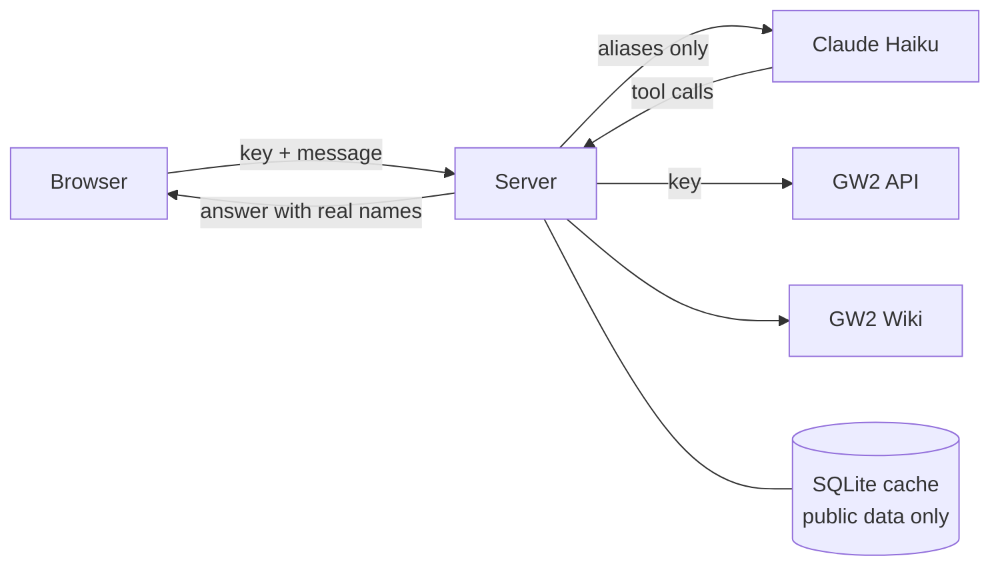

<p align="center"></p>

<h1 align="center">GW2 Wayfinder</h1>

<p align="center"><a href="https://github.com/bucsai/gw2-wayfinder/actions/workflows/ci.yml"></a></p>

A web-based Guild Wars 2 assistant at [gw2wayfinder.com](https://gw2wayfinder.com). It answers questions about the game and about your account, using the official GW2 API and the official GW2 Wiki.

> [!NOTE]
> GW2 Wayfinder is an unofficial fan project. It is not affiliated with or endorsed by ArenaNet or NCSOFT. See [Legal](#legal).

## Privacy

- You need a read-only GW2 API key. Create one at [account.arena.net/applications](https://account.arena.net/applications).
- The key stays in your browser. It is kept for the browser session, or on your device if you choose "Remember my key".
- The server keeps chats in memory for up to one hour and never writes account data to disk.
- Account, character and guild names are replaced with aliases (such as `Character_A`) before anything is sent to the AI model. Real names are put back into the answer you see.
- The API key is never sent to the AI model.
- Messages, with names replaced, are processed by Anthropic. The site is served through Cloudflare.

The full privacy notice is at [gw2wayfinder.com/privacy.html](https://gw2wayfinder.com/privacy.html) ([source](static/privacy.html)).

## How it works



The agent is built with [Pydantic AI](https://ai.pydantic.dev). It has tools for:

- Account: overview, characters, character gear and build, wallet, item search across storage, Trading Post orders, achievements, Wizard's Vault, weekly clears
- Game data: items, Trading Post prices, recipes, achievements
- Wiki: search and page reading

Tools that need a permission the key lacks are hidden from the agent.

The chat id is kept per browser tab, so a reload or a visit to the privacy page restores the chat while the server still has it.

> [!NOTE]
> Wiki results are cached without expiry. Wiki requests run one at a time, at most one per second, and stop for a while when the wiki is busy.

## Usage limits

Per API key, in any 10 minutes: at most 20 messages and 5 new chats. One answer per key runs at a time, and at most 5 across the server.

## Running locally

Requirements: [uv](https://docs.astral.sh/uv/) and an Anthropic API key.

```sh
uv sync
export ANTHROPIC_API_KEY=...
uv run uvicorn app.main:app --reload
```

Open http://127.0.0.1:8000.

Checks:

```sh
uv run pytest --cov                          # tests with coverage, fails under 80%
uv run --env-file .env pytest tests/test_live.py  # tools against the real GW2 API, needs GW2_TEST_API_KEY
uv run ruff check && uv run ruff format      # lint and format
uv run pyright                               # type check
```

## Running with Docker

Copy `.env.example` to `.env` and fill in the values.

```sh
docker compose up -d --build                  # app only, on 127.0.0.1:8000
docker compose --profile tunnel up -d --build # app and Cloudflare Tunnel
```

The cache is stored in the `wayfinder-data` volume, so it survives restarts and rebuilds.

> [!WARNING]
> `docker compose down -v` deletes the cache volume.

For the tunnel, create a Cloudflare Tunnel, put its token in `.env`, and route the public hostname to `http://app:8000`.

## Configuration

| Variable | Default | Description |
| --- | --- | --- |
| `ANTHROPIC_API_KEY` | | Anthropic API key |
| `CLOUDFLARE_TUNNEL_TOKEN` | | Cloudflare Tunnel token, only for the `tunnel` profile |
| `WAYFINDER_MODEL` | `anthropic:claude-haiku-5-5` | Pydantic AI model name |
| `WAYFINDER_DATA_DIR` | `data` (`/data` in Docker) | Directory of the SQLite cache |

## Legal

GW2 Wayfinder is an unofficial fan project, made under ArenaNet's [Content Use Policy](https://www.arena.net/legal/content-terms-of-use). It is not affiliated with or endorsed by ArenaNet or NCSOFT. Answers are generated by AI and can be wrong.

© ArenaNet LLC. All rights reserved. NCSOFT, ArenaNet, Guild Wars, Guild Wars 2, GW2, Heart of Thorns, Path of Fire, End of Dragons, Secrets of the Obscure, Janthir Wilds, Visions of Eternity, and all associated logos, designs, and composite marks are trademarks or registered trademarks of NCSOFT Corporation. All other trademarks are the property of their respective owners.

Game information comes from the [Guild Wars 2 API](https://wiki.guildwars2.com/wiki/API:Main) and the [Guild Wars 2 Wiki](https://wiki.guildwars2.com). Wiki text is available under the [GNU Free Documentation License 1.3](https://www.gnu.org/licenses/fdl-1.3.html).

The source code is available under the [MIT License](LICENSE). The bundled [Cinzel](https://github.com/NDISCOVER/Cinzel) font is available under the [SIL Open Font License 1.1](static/vendor/fonts/OFL.txt).
